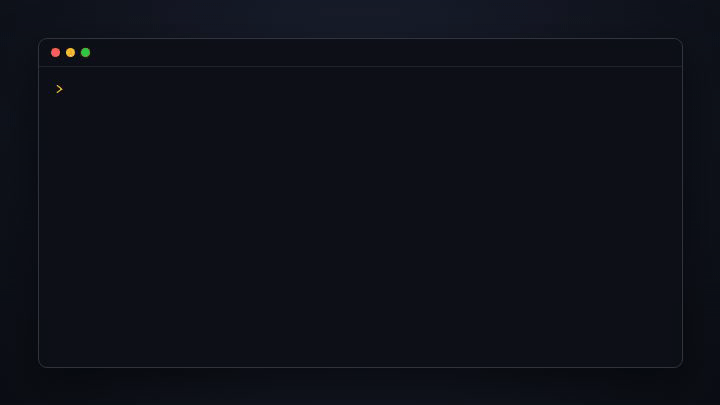

<p align="center"></p>
<h1 align="center">loot</h1>
<p align="center"><b>Every AI session drops loot. <code>/loot</code> finds it, polishes it, ships it.</b></p>

<p align="center"></p>

An AI session can produce working code, a useful fix, a decision, or corrections
that improve the next attempt. Loot helps preserve those results beyond the chat.

**Loot is an agent skill**: instructions your existing agent follows to read
session material and keep selected findings in
`LOOT.md`. Its default capture mode:

1. **Reads** the available session or supplied transcript for worthwhile results: the main build,
   side discoveries, techniques, and the feedback you taught the agent.
2. **Records selected findings** with their evidence, limitations and usefulness
   in `LOOT.md`, checking for earlier entries before adding duplicates.
3. **Stops after capture**, without web searches, an outside rater or publication.

When requested, `/loot assess` researches public alternatives and assesses rarity
separately. A selected item can then be developed into a repo, agent skill, post,
gist or demo using the tools your agent has. That publication workflow includes
validation, secret checks and approval of the exact release manifest. If a needed
capability is unavailable, Loot supplies a fallback where possible and identifies
what remains for you to do.

## Usefulness and rarity are separate

**Usefulness** describes practical value to the user or workflow, supported by
context such as avoided rework, a recurring need or a known mistake prevented.
**Rarity** describes the evidence for distinction from public alternatives.

Rare and Epic items can be highly useful. Common items can also be highly useful.
Neither rating determines the other: rarity requires evidence about alternatives,
while usefulness requires evidence about the task and its impact. Completing an
important one-time task does not automatically make its usefulness Low; the
benefit matters as well as the likelihood of reuse.

Loot currently records **two ratings**, not separate scores for past benefit,
future reuse and value to other people. Explain those distinctions in the entry
when relevant, and name whose workflow the usefulness judgment concerns.

| Usefulness | Meaning for this user or workflow |
|---|---|
| **High** | Substantial observed rework avoided, a recurring need, or an important recurring failure prevented. Recurrence is not required when the observed benefit already supports this rating. |
| **Medium** | Concrete likely reuse or a known mistake avoided; repeat impact not yet established. |
| **Low** | A minor detail with little expected carry-forward value and no substantial demonstrated benefit. Being a one-off is not sufficient by itself. |
| **Unknown** | Insufficient context; missing evidence is not automatically low value. |

### Capture first

`/loot` and `/loot capture` preserve lessons quickly. They rate usefulness,
record evidence and its limits, save `LOOT.md`, and stop. They do not run web
searches, call a separate rater, rerun tests or ask what to publish. Rarity
stays **Not assessed**, or retains a dated previous assessment.

Without an outside rater, the agent that helped build the work is the one
rating it, so capture is strict about **High**: it needs a quote or a count
from the session (the repeated use, the correction, the observed cost), and
more than two Highs in one session must be explained. Otherwise it's Medium.

### Assess rarity when needed

`/loot assess` adds searches and an independent rater when available, with a
documented self-review fallback. These labels describe public distinction,
not whether the work deserves to be remembered:

| Rarity | Needs all of | Possible forms when selected |
|---|---|---|
| **Common** | anything below Rare | retain according to usefulness; publish if explicitly selected, without unsupported novelty claims |
| **Rare** | a real search query; a search that found nothing equivalent (with links), or a measured edge over the closest result; proof it works | gist, short post, or a small repo or skill |
| **Epic** | Rare, plus a measured edge over a named alternative, and it runs from a clean clone | repo or skill, post, demo, launch drafts |

In a full rarity assessment, "not checked" or "no proof" means Common.
Unassessed capture entries are not automatically Common. Ties round down. Anything rated
above Common shows its evidence, so you can disagree. A near miss
(`[COMMON, near Rare]`) comes with a `next:` line: the cheapest evidence that
would raise it and roughly how long it takes.

Historical checks count when their source is traceable and their scope is
clear. Label evidence **fresh**, **recorded historical**, **reported historical**
or **absent**. Inspected historical command/results or artifacts can establish
working proof without a new run. An uninspected summary can inform usefulness
but is not verified execution. Recheck when code, dependencies or the claim
has changed, or before making a current-release validation claim.

### loot rates itself Common

The first version rated itself Epic, which was flattering itself.
[Feedback](posts/loot.md#the-filter-was-flattering-me) pointed that out, the
rules above replaced the vibes, and here is the re-rated table from the
session that built this repo ([LOOT.md](LOOT.md)):

```
LOOT: 4 drops
1. [COMMON] loot-skill: an agent skill that finds and ships the valuable parts of AI sessions
   search: 6 similar tools (see below); its differences are real but not measured
2. [COMMON] scan.mjs: zero-dependency secret scanner → gitleaks does far more
3. [COMMON] naming a dev tool: hatch → afterchat → sidequest → loot → only interesting to us
4. [COMMON] scratch preview server for checking the logo → throwaway
Nothing above Common. 4 drops saved to LOOT.md.
```

It was published because it was useful and built in the open. Common is not
a publication ban: an explicit user selection can ship familiar guidance,
provided its claims are accurate and the release checks pass. The table above
is historical and predates the separate usefulness rating.

## Install

**Claude Code**

```
/plugin marketplace add hamgarian/loot-skill
/plugin install loot@loot-skill
```

**Other agents that support [Agent Skills](https://github.com/vercel-labs/skills)** (Codex, Cursor, Gemini CLI, …)

```bash
npx skills add hamgarian/loot-skill -g                  # every project
npx skills add hamgarian/loot-skill -g -a codex         # one specific agent
```

The repository includes Claude Code and Codex plugin metadata and a portable
`SKILL.md`. The original workflow was developed in Claude Code; the separate
usefulness and mode evaluations were run with Codex agents. Capabilities such as
search, subagents, file access and publishing depend on the host agent.

**ChatGPT, claude.ai or any chat app:** paste
[`skills/loot/SKILL.md`](skills/loot/SKILL.md) and say "run loot on this conversation".

## Your first loot

The output below is an illustrative example; yours will differ.

**1. Work as usual.** Build the thing, fix the bug, argue with the agent until
the output is right. loot needs nothing from you during the session.

**2. Type `/loot` when you're done.** It reads the session and saves a short
capture table, for example:

```text
LOOT: 2 drops — capture
1. [usefulness: High | rarity: Not assessed] Trim feedback audio to its audible attack.
   useful because: the same silent lead-in caused repeated sync corrections.
   evidence: recorded historical render notes, inspected; audio not auditioned now.
2. [usefulness: Medium | rarity: Not assessed] Reserve caption space before placing cursor targets.
   useful because: caption reflow moved the next button in this edit.
Saved to LOOT.md. No publication requested.
```

**3. Assess only when useful.** `/loot assess` researches public alternatives
and adds rarity alongside usefulness. The following is an illustrative
assessment table:

```
LOOT: 3 drops
1. [RARE | usefulness: High] remotion-ae-transitions: After Effects-style transitions in Remotion, fully local
   useful because: the workflow repeatedly needed these transitions
   query:  "remotion after effects transitions"
   search: @remotion/transitions (slides, fades, wipes), one paid template pack; none do these
   proof:  6 transitions rendered and approved in this session
   edge:   not measured, so not Epic → gist + short post
   next:   render the same 3 shots with @remotion/transitions and compare (~45 min)
2. [COMMON | usefulness: High] ffmpeg two-pass trick: recurring export fix; documented in the ffmpeg wiki → LOOT.md
3. [COMMON | usefulness: Medium] custom font loader: avoids repeating project setup → LOOT.md
Ship which? (numbers, "all", or "none")
```

Read the evidence lines, not just the label. If the search missed something or
the proof is thin, say so and it re-rates.

**4. Prepare a selected item.** Answer `1` or use `/loot 1`. A useful Common
item is also eligible if you choose it. loot builds it in a new folder (clean
code, README, logo, tests), scans it for secrets, then stops and shows you a
manifest:

```
Will publish:
  github.com/you/remotion-ae-transitions   public, 9 files, secret scan clean
  gist: "ae-style transitions for Remotion"  public
  posts/remotion-ae-transitions.md          draft, not posted
Go ahead? (yes / change something / no)
```

No artifact is published until you approve its exact destinations and files.

**5. Come back to it.**

- Forgot to loot a session? `/loot --list`, then `/loot <file>` from the list.
- `/loot review` refreshes usefulness and evidence. Prior rarity is preserved
  with its date unless you request a researched reassessment.
- Want a nudge? Turn on the [end-of-session reminder](#end-of-session-reminder-optional).

## Use

```
/loot                   capture lessons, rate usefulness, save and stop
/loot capture           explicit lightweight capture; no search or outside rater
/loot "the ffmpeg trick"  capture one thing only
/loot assess            research rarity and rate usefulness independently
/loot 2                 prepare drop #2; publication still needs manifest approval
/loot all               prepare Rare-or-better drops; publication still needs manifest approval
/loot --list            list your recent Claude Code and Codex sessions
/loot <session file>    capture a past session: Claude Code / Codex .jsonl, or an .md/.txt export
/loot review            refresh usefulness/evidence; preserve prior dated rarity unless reassessment requested
/loot --auto            unattended lightweight capture; write only LOOT.md
/loot assess --auto     unattended researched assessment; write only LOOT.md
```

Or just say "loot this session" or "what from this is worth shipping?"
`--auto` overrides shipping arguments and never asks, forges or publishes.

### End-of-session reminder (optional)

The Claude Code plugin ships a hook that, once per long session (30+ messages),
says *"Anything worth keeping? Run /loot."* It never runs loot itself, and it's
off until you turn it on in `~/.claude/settings.json`:

```json
{ "env": { "LOOT_REMIND": "1" } }
```

## Uses what your agent has

Loot uses the host agent's capabilities. Its instructions provide fallbacks
for missing tools; those fallbacks may leave a manual step rather than complete
the original action automatically.

| Need | Preferred capability | Fallback |
|---|---|---|
| Logo / cover image | your agent's image generation or an image MCP | hand-written SVG |
| Secret scan | [gitleaks](https://github.com/gitleaks/gitleaks), including git history | bundled `scan.mjs` |
| Demo video | [Remotion](https://www.remotion.dev) | screenshots + GIF |
| "Does this exist?" (full assessment) | web search | assessed rarity is capped at Common; usefulness stays independent |
| Independent rarity rating (full assessment) | a subagent that never sees your conversation | the strongest case for Common, written first |
| Publish repo | `gh` CLI | the commands, printed for you |
| Publish post | dev.to / Hashnode API (draft) with your existing token | a Markdown file |

## Publication safeguards

The skill instructs the agent to:

- Obtain approval for the exact destinations and files before publishing.
- Use existing authentication rather than requesting or storing credentials.
- Scan each publication folder with the bundled scanner
  ([`scan.mjs`](skills/loot/scripts/scan.mjs), zero dependencies) and gitleaks
  when you have it. Old git history is never pushed unless gitleaks scanned it.
- Exclude private/client work and respect the licenses of third-party code.
- Leave social launch posts as drafts for you to post.
- Support claims with recorded evidence rather than inventing results.

These are agent instructions, not a separate enforcement service. The bundled
scanner detects known patterns; its limitations are described below.

## How it works

It's two `SKILL.md` files plus reference files and a secret scanner: no server,
no account, no dependencies beyond Node for the scanner. The agent you already
use does the work with the tools it already has.

```
skills/loot/
  SKILL.md              capture → usefulness; assess rarity → forge → check → ship when requested
  references/forge.md   checklists for repo, skill, post, gist, demo, name, logo
  references/ship.md    publish commands and fallbacks
  scripts/scan.mjs      secret scanner (node scan.mjs <folder>)
  scripts/transcript.mjs  reads past sessions (Claude Code, Codex, any text export), secrets redacted
evals/                  rarity/usefulness cases + a scorer; prompt built from SKILL.md itself
skills/skill-factory/
  SKILL.md              spec → tests first → independent review → release gate
  references/release-checklist.md  what the reviewer checks before anything ships
hooks/remind.mjs        optional end-of-session reminder
```

When a drop's form is a skill, loot hands it to **skill-factory**, which also
works on its own (`/skill-factory <idea>`). It requests review by a fresh
subagent when available. Otherwise, the builder writes a case for failure
against every checklist item before deciding whether it passes.

Ideas borrowed from the similar tools below: reading past transcripts
(logex), re-rating the journal over time (retro, learning-loop), a cap on
how much one run reports (retro), a bar for what's worth writing down and a
rule against invented evidence (learning-loop), an opt-in reminder instead
of auto-running (retro), evals for the judging step (retro), seen-again and
stale tracking, a narrower home for each lesson, and an unattended mode
(compound-engineering's ce-compound), and a cold-read pass on everything
written for publication (session-to-post's slop-detector).

### Does the rating work?

[`evals/`](evals/) holds the original 13 rarity fixtures, one taken
from a real run, plus separate usefulness/historical-evidence cases.
Under the earlier rarity-only rules, fresh raters scored **13/13**,
agreed with each other on every item, and across all
eight runs **never rated an item higher than its evidence supported**.
Earlier misses were near-miss tags, not tiers, and each one led to a rule fix.

### Head-to-head with ce-compound

On 4 real past sessions, each with a fake credential planted in it, loot
captured **37 of 46** things an independent judge said were worth keeping
(19 of 20 high-importance ones) and leaked nothing. compound-engineering's
`ce-compound` wrote nothing on any of them, as its own rules say it should:
it only documents solved bugs that the code doesn't already explain. In that
small sample, Loot captured a broader range of session findings. This does not
establish that it is the better tool for every journaling or bug-documentation
task. Setup, numbers and limits:
[`evals/head-to-head.md`](evals/head-to-head.md). Details and how to rerun them: [`evals/README.md`](evals/README.md).

The initial version was built in one Claude Code session and then looted with
itself. That write-up is in [`posts/`](posts/); later changes are recorded in
[CHANGELOG.md](CHANGELOG.md).

## Similar tools

Found by running loot's own existence check on itself:

- [compound-engineering](https://github.com/EveryInc/compound-engineering-plugin) `ce-compound`: writes durable, non-obvious solved problems to `docs/solutions/`; doesn't publish.
- [session-to-post](https://github.com/athola/claude-night-market) (claude-night-market): turns a session into a blog post, case study or Reddit post.
- [logex](https://github.com/iamtouchskyer/logex): turns Claude Code transcripts into blog-style articles.
- [work-to-blog-publisher](https://github.com/greeun/work-to-blog-publisher): Claude Code skill that publishes session work to GitHub and WordPress.
- [insight-capture](https://github.com/xmoonanx/insight-capture): Claude Code and Codex session insights into Jekyll posts.
- [mentor](https://github.com/smixs/mentor): session-insights skill that reads your local Claude Code and Codex history.
- [retro-skill](https://github.com/netresearch/retro-skill): finds friction in agent sessions and turns learnings into config.
- [learning-loop-skill](https://github.com/melodykoh/learning-loop-skill): captures learnings before the session ends.
- [SpecStory](https://github.com/specstoryai/getspecstory): saves AI IDE and terminal agent histories for reuse.

loot's differences: lightweight capture, separate usefulness and novelty
ratings, a secret-scan and approval
gate before anything goes public, and one pass that can produce a repo, skill,
post or demo. The rating is tested on known cases, and loot was run side by
side with ce-compound on real sessions (above); the other tools haven't been
compared yet.

## Limits

- Past sessions are parsed from Claude Code and Codex transcripts; other
  agents need a Markdown or text export of the conversation. Very long
  transcripts are cut in the middle (start and end kept), and loot says so.
- The bundled scanner is a safety net (known key formats, `.env` files,
  passwords in URLs), not a full audit. Install gitleaks for the real thing.
- Ratings are still an LLM's judgment. The evidence rules, the checklist and
  the outside rater reduce flattery, and the evals show it holds on known
  cases; a finite fixture set is not every case. Read the context and cited
  evidence, not just either label. Prior historical benchmarks describe the
  older rules and have not been rerun as comparisons of this capture mode.

## License

MIT
